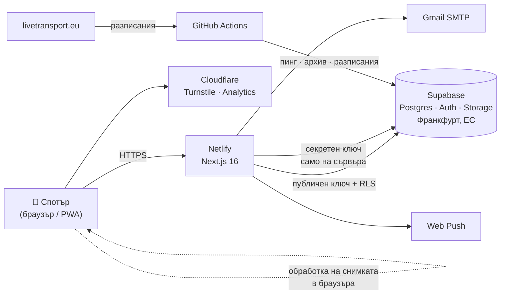

<div align="center">


# busspotburgas

**Общностният сайт на спотърите на Бургасбус**<br/>
Снимки на всяка кола по номер · титуляри и ортаци · точки и класации · линии и разписания

[**busspotburgas.netlify.app**](https://busspotburgas.netlify.app) &nbsp;·&nbsp; [Правила](https://busspotburgas.netlify.app/bg/rules) &nbsp;·&nbsp; [Поверителност](https://busspotburgas.netlify.app/bg/privacy)


</div>

---

## За проекта

**busspotburgas** е безплатен общностен сайт за любителите на градския транспорт в Бургас. Всяка кола от автопарка на „Бургасбус“ има своя страница, а спотърите качват снимки, избират си „титуляр“, събират точки и се борят за върха в класациите.

- 🆓 **Изцяло безплатен** – работи на безплатните планове на Netlify, Supabase, Cloudflare и GitHub.
- 🚫 **Без реклами и без проследяване** – само бисквитка за вход и анонимна статистика без бисквитки.
- 🇧🇬 🇬🇧 **Двуезичен** – български и английски.
- 📱 **Инсталира се като приложение** (PWA) с push известия и работа без интернет.

> Сайтът е неофициален и не е свързан с „Бургасбус“ ЕООД или с Община Бургас.

## Възможности

<table>
<tr>
<td width="50%" valign="top">

### 🚌 Автопарк
- 166 коли в 9 модела със силуети и статуси (в движение, нова, в сервиз, спряна…)
- Страница за всяка кола: снимки, титуляри, оценки, описание, история на рекламите
- **История** на бракуваните коли

### 📸 Снимки
- Качване с обработка **още в браузъра**: смаляване, WebP, махане на GPS/EXIF
- Автоматично **замазване на лица** (MediaPipe) и воден знак
- Изрязване 16:9, откриване на дубликати
- Одобрение от админа, „Това е моя снимка“
- **„Сподели в story“** – готова картинка за TikTok/Instagram

</td>
<td width="50%" valign="top">

### 🤝 Общност
- Титуляри, ортаци с покани и гласуване за собственик
- Оценки, харесвания, коментари, следване
- Известия в сайта, по имейл и **push** на телефона

### 🏆 Игра
- Точки, рангове и значки
- Месечни и общи класации, албум със стикери
- **Снимка на месеца** и **спотър на месеца**

### 🗺️ Линии и търсене
- Всички **27 линии** на Бургасбус – маршрут по спирки и часове
- Търсачка по номер, линия, спотър и реклама

</td>
</tr>
</table>

## Технологии

| Слой | Избор |
| --- | --- |
| Приложение | [Next.js 16](https://nextjs.org) (App Router, Cache Components, Server Actions), React 19, TypeScript |
| Дизайн | Tailwind CSS 4, шрифтове Unbounded + Inter |
| База, вход, файлове | [Supabase](https://supabase.com) – Postgres с RLS, Auth (имейл, Google, 2FA), Storage, pg_cron |
| Хостинг | [Netlify](https://www.netlify.com) + Scheduled Functions |
| Имейли | Gmail SMTP (Nodemailer) |
| Защита от ботове | Cloudflare Turnstile |
| Статистика | Cloudflare Web Analytics (без бисквитки) |
| Push | Web Push (VAPID) + Service Worker |
| Автоматизация | GitHub Actions |

## Как е устроен



## Структура

```text
src/
├─ app/[lang]/        страници (bg/en): начало, автопарк, кола, снимка, линии, класации, профил, админ…
├─ app/auth/          връзки от имейл и Google
├─ components/        части от интерфейса
├─ lib/               логика: Supabase, вход, снимки, известия, игра, линии, търсене
└─ dictionaries/      всички текстове – bg.json, en.json
supabase/migrations/  схемата на базата, правила (RLS), функции, cron
netlify/functions/    нощни задачи (почистване, напомняния, месечни награди)
scripts/              автопарк → SQL, иконки, изтегляне на разписанията
data/                 fleet.json – автопаркът
.github/workflows/    пинг, архив, разписания, gitleaks
docs/                 спецификация и STATUS.md
```

## Пускане на компютъра

```bash
git clone https://github.com/BusSpotBurgas/busspotburgas-site.git
cd busspotburgas-site
npm install
cp .env.example .env.local   # попълни ключовете
npm run dev                  # http://localhost:3000
```

### Ключове

Ключовете **никога** не влизат в git – само в `.env.local` и в настройките на Netlify / GitHub.

| Променлива | Къде | Тайна |
| --- | --- | :---: |
| `NEXT_PUBLIC_SUPABASE_URL` | Netlify, `.env.local` | – |
| `NEXT_PUBLIC_SUPABASE_PUBLISHABLE_KEY` | Netlify, `.env.local` | – |
| `NEXT_PUBLIC_TURNSTILE_SITE_KEY` | Netlify, `.env.local` | – |
| `NEXT_PUBLIC_CF_BEACON_TOKEN` | Netlify | – |
| `SUPABASE_SECRET_KEY` | Netlify, `.env.local`, GitHub | 🔒 |
| `GMAIL_APP_PASSWORD` | Netlify | 🔒 |
| `VAPID_PRIVATE_KEY` | Netlify, `.env.local` | 🔒 |
| `SUPABASE_URL`, `SUPABASE_PUBLISHABLE_KEY`, `SUPABASE_DB_URL` | GitHub Actions | 🔒 |

### Команди

| Команда | Какво прави |
| --- | --- |
| `npm run dev` | сървър за проби |
| `npm run build` | компилиране за продукция |
| `npm run db:sql` | `data/fleet.json` → `supabase/setup.sql` и `seed.sql` |
| `npm run lines:live` | изтегля линиите и разписанията на Бургасбус |
| `npm run icons` | генерира иконките на приложението |

## Автоматизация

| Задача | Кога | Какво |
| --- | --- | --- |
| Пинг на Supabase | всеки ден | безплатната база не „заспива“ |
| Архив на базата | всяка неделя | `pg_dump` → Actions Artifacts (90 дни) |
| Разписания | всеки понеделник | обновява линиите и часовете |
| gitleaks | при всяко качване | проверка за изтекли ключове |
| Нощни задачи (Netlify) | всеки ден | почистване, напомняния, избори, месечни награди |

## Работен процес

- Работи се в клон **`dev`**; в **`main`** се качва по веднъж на етап – всяко качване на сайта струва 15 от 300-те месечни кредита в Netlify.
- Промени само по документацията, GitHub, базата или скриптовете **не** пускат ново качване на сайта.
- Commit-ите са от **BusSpotBurgas**.

## Сигурност и поверителност

- Row Level Security на **всяка** таблица; админ действията изискват роля **и** 2FA.
- Тайните ключове са само на сървъра; паролите са хеширани (bcrypt).
- От снимките се махат GPS данните, лицата се замазват – още в браузъра.
- Данните са в ЕС (Франкфурт); „Изтегли моите данни“ и изтриване на профила от Настройки.
- Прегледан по 12 проверки за сигурност – подробно в [`docs/STATUS.md`](docs/STATUS.md).

## Източници на данни

- Автопарк – [trinmo.org](https://trinmo.org/public-transport/fleet-list?city=burgas)
- Линии и разписания – данните на „Бургасбус“ чрез [livetransport.eu](https://livetransport.eu/#/burgas/routes)

## Контакт

📧 **busspotburgas@gmail.com**

<div align="center">
<sub>Направено с ❤️ за спотърите в Бургас · © 2026 busspotburgas · Всички права запазени</sub>
</div>
